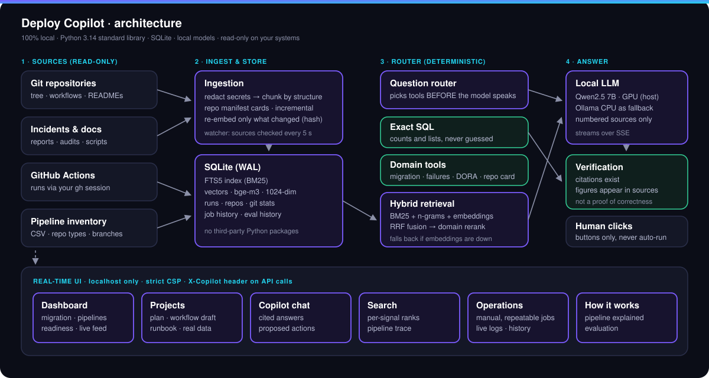
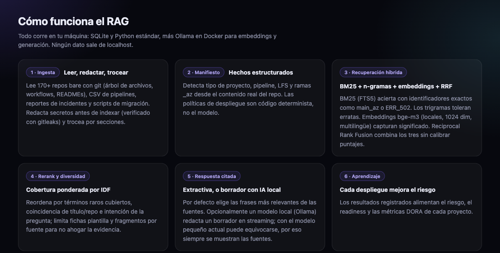
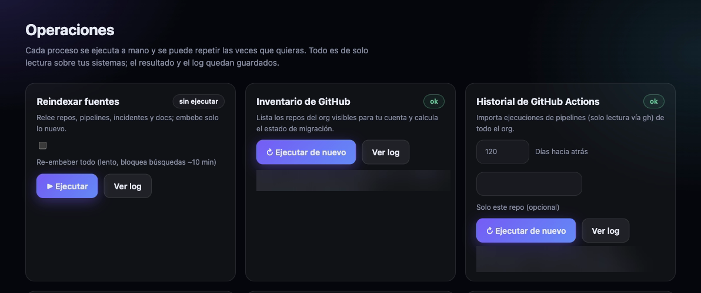

<div align="center">

# Deploy Copilot

**A local, read-only RAG and deployment copilot for engineering teams.**
Hybrid retrieval over your repositories, pipelines and incident reports — cited answers, exact SQL for counting questions, real CI/CD history and a real-time UI.




</div>

---

## Contents

[What it does](#what-it-does) · [Screenshots](#screenshots) · [How the RAG works](#how-the-rag-works) · [Copilot and tools](#copilot-and-tools) · [Manual, repeatable jobs](#manual-repeatable-jobs) · [Quick start](#quick-start) · [Configuration](#configuration) · [API](#api) · [Security](#security) · [Evaluation](#evaluation) · [Known limitations](#known-limitations) · [Project layout](#project-layout) · [Roadmap](#roadmap)

---

## What it does

Deploy Copilot answers questions about your infrastructure and helps plan deployments and a migration from Azure DevOps to GitHub. It indexes **your own data** — repositories, workflow files, incident reports, technical documents and the real run history of your CI — and keeps everything on your machine.

- **Hybrid RAG:** BM25 + character n-grams + embeddings, fused with *Reciprocal Rank Fusion* and re-ranked with domain signals.
- **Cited answers:** every sentence references its source `[n]` and is verified automatically.
- **Exact where it matters:** counting and listing questions are answered with **SQL**, not by the model.
- **Real data:** migration status, pipeline failure rates and DORA-style metrics computed from actual CI runs.
- **Manual, repeatable operations:** every process is one click, can be repeated, and leaves a log and a history.
- **Local and read-only:** no data leaves the machine and **nothing is ever deployed automatically**. Everything generated is a draft for human review.
- **No third-party packages:** the backend uses only the Python standard library, so there is no `pip` supply chain to audit.

The web interface is in Spanish.

## Screenshots

<div align="center">



*The retrieval pipeline, explained inside the UI.*



*Manual, repeatable jobs (result figures are blurred in this capture).*

</div>

## How the RAG works

```
Sources ─► Ingestion ─► SQLite (FTS5 + vectors) ─► Hybrid retrieval ─► Cited answer
                                                    │                    │
                                    BM25 · n-grams · semantic     extractive or local LLM
                                           │                             │
                               RRF fusion → rerank → diversity    citation verification
```

### 1. Ingestion (`ingest.py`)

- Reads bare git repositories with `git show` (file tree, workflows, READMEs) without cloning them.
- Adds pipeline inventories (CSV), incident reports, audits, technical documents and migration scripts.
- **Structure-aware chunking:** Markdown by headings (≤ ~1,800 chars); scripts and YAML by blocks (~1,400).
- **Secret redaction before chunking and indexing**, including each chunk's title and source (`common.py`): GitHub tokens, credentials in URLs, `*_SECRET`/`*_TOKEN` variables, private keys, cloud client secrets and long opaque values. Rules are linear-time (no per-position retries), input is cut only at a safe boundary, and name-based rules run before the generic long-token rule so a long identifier cannot hide its value.
- One **structured card per repository** (type, pipeline, branches, LFS) to answer inventory questions.
- **Incremental re-indexing:** vectors are stored by `sha1(text)`, so only changed chunks are re-embedded. A watcher checks the sources every 5 s.

### 2. Hybrid retrieval (`rag.py`)

Three independent retrievers, 40 candidates each:

| Signal | Technique | Strong at |
|---|---|---|
| **BM25** | SQLite FTS5, accent-insensitive tokenizer, extra weight on titles | Exact identifiers: error codes, branch names |
| **N-grams** | Character trigrams, TF-IDF cosine | Typos and morphological variants |
| **Semantic** | `bge-m3` embeddings (1,024-dim, multilingual), dot product | Meaning: "port exhaustion" ≈ "SNAT exhaustion" |

**Fusion (RRF)** works on rank, not score, so the three scales never need calibrating:

```
rrf(doc) = Σ weight_i / (60 + rank_i)          weights: BM25 1.0 · n-grams 0.5 · semantic 1.0
```

**Re-ranking** with domain signals:

```
score = rrf_normalised + 0.5·idf_coverage + 0.08·(title match) + 0.15·(repo mentioned) + intent_bonus (0.10–0.18)
```

- **IDF coverage** makes a rare term (`main_az`) weigh more than a common one (`main`).
- **Intent** boosts the right source type: "502" → incidents; "migrate" → migration scripts.
- **Diversity:** at most 2 chunks per source, and repository cards are capped so they never crowd out evidence.
- **Graceful degradation:** if the embedding service is down, search continues with BM25 and n-grams and the UI says so.

### 3. Answering

- **Extractive (no LLM):** picks the most relevant sentences from the best sources.
- **Generative (optional):** `Qwen2.5 7B` on the host GPU through Docker Model Runner (Ollama on CPU as a fallback), temperature 0.1, streamed. The prompt forces numbered sources only, a citation on every sentence, context treated as data rather than instructions, and no invented repositories, commands or figures.
- **Post-check:** every citation must point to an existing source and every figure must appear in the sources.

> The check **cannot detect errors of interpretation** — in one test the model inverted the meaning of a fact and still passed. The UI therefore always exposes the sources.

## Copilot and tools

A **deterministic router** (regular expressions) selects the tool *before* the model speaks. The model only writes from the sources it is given and **never executes anything**.

| Question | Tool | LLM? |
|---|---|---|
| "how many repos…", "which repos…" | Exact SQL over the index | No |
| Migration Azure → GitHub | Inventory comparison | No |
| Failing pipelines, DORA | Computation over real CI runs | No |
| "how is repo X doing" | Card: index, git, pipelines, workflows | No |
| Incidents, documents | Hybrid RAG | Yes |
| "reindex", "import the history" | Proposes a button; a person clicks it | No |

It exists for a measured reason: without the SQL route the model answered "17 Terraform repos" when the real figure was 6.

## Manual, repeatable jobs

From the **Operaciones** view every process runs with one click, can be repeated or cancelled, and keeps a live log and a history. The job list is **closed** (nothing outside the registry can run), parameters are validated, and only one run per job executes at a time.

| Job | What it does |
|---|---|
| `reindex` | Re-reads sources and embeds only what is new (option to re-embed everything) |
| `github_inventory` | Lists the organisation's repositories visible to your account and computes migration status |
| `history_gh` | Imports GitHub Actions runs (read-only, through `gh`) |
| `history_azure` | Azure DevOps build history. **Untested:** needs a read-only `AZURE_DEVOPS_EXT_PAT` in the server environment |
| `gitstats` | Commits, authors and activity of the local repositories |
| `evaluate` | recall@5 and MRR of the four retrievers; **refuses to record** incomplete results |
| `secrets_scan` | `gitleaks` over the indexed text |
| `health` | State of the local LLM, embeddings and data |

## Quick start

### Requirements

| Component | Used for | Notes |
|---|---|---|
| Python 3.14 | The whole backend | Only tested version (modern type syntax; older versions unverified). Standard library only; SQLite with FTS5 |
| `git` | Reading repositories | |
| Docker Desktop | Embeddings (Ollama) and generation (Model Runner) | See "Known limitations" about disk mounts |
| `gh` (GitHub CLI) | Inventory and Actions history | Authenticated with a **read** account |
| `gitleaks` | Auditing the index | Optional |

### Models (once)

```bash
docker run -d --name copilot-ollama --restart unless-stopped \
  -p 127.0.0.1:11434:11434 -v "$PWD/models:/root/.ollama" ollama/ollama:latest
docker exec copilot-ollama ollama pull bge-m3        # embeddings, MIT licence
docker model pull ai/qwen2.5                          # 7B generation, Apache-2.0, runs on the host GPU
```

### Run

```bash
cp .env.example .env     # set COPILOT_GH_ORG (and COPILOT_AZDO_ORG if you use the Azure job)
./run.sh                 # starts Ollama if needed, indexes, embeds, serves http://127.0.0.1:8765
```

Or step by step:

```bash
python3 ingest.py                 # index (~7 s)
python3 embed.py                  # incremental embeddings
python3 server.py                 # UI + API on 127.0.0.1:8765   (COPILOT_PORT to change)
python3 evaluate.py               # evaluate the retrievers
python3 plans.py plan <repo> --env prod    # CLI version
```

## Configuration

| Variable | Default | Description |
|---|---|---|
| `COPILOT_GH_ORG` | — (required for GitHub jobs) | GitHub organisation or user whose repositories are read |
| `COPILOT_AZDO_ORG` | — | Azure DevOps organisation (Azure history job only) |
| `COPILOT_GENERIC_TOKENS` | — | Comma-separated name prefixes ignored when fuzzy-matching repository names |
| `COPILOT_PORT` | `8765` | UI port (always bound to `127.0.0.1`) |
| `COPILOT_OLLAMA` | `http://127.0.0.1:11434` | Embedding server |
| `COPILOT_EMBED_MODEL` | `bge-m3` | Embedding model |
| `COPILOT_GEN_BACKEND` | `auto` | `auto` · `dmr` (Model Runner) · `ollama` |
| `COPILOT_DMR_MODEL` | `ai/qwen2.5` | Generation model on Model Runner |
| `COPILOT_GEN_MODEL` | `qwen2.5:1.5b-instruct` | Fallback generation model on Ollama |
| `COPILOT_W_SEM` | `1.0` | Weight of the semantic retriever in the fusion |
| `AZURE_DEVOPS_EXT_PAT` | — | Azure job only; read at run time and never stored |

**Data sources.** `ingest.py` reads, relative to the project's parent folder: `migration/<repo>/` (bare repositories), `repo_github/*.csv`, `REPORTE_*.md`, `SECURITY-AUDIT.md` and `Documentacion/**/*.md`. Adjust `WORK` in `common.py` and the paths in `ingest.py` for a different layout. No source data is included in this repository.

## API

Bound to `127.0.0.1`. Every `GET` (except the event stream) and every `POST` requires the header `X-Copilot: 1`; `POST` also requires `Content-Type: application/json`.

| Method and path | Description |
|---|---|
| `GET /api/events` | Real-time SSE stream; reconnect with `Last-Event-ID` |
| `GET /api/search?q=&kind=` | Hybrid search with a per-signal trace |
| `GET /api/answer?q=` | Streamed generated answer with citation verification |
| `POST /api/chat` | Copilot: context, tokens and verification, streamed |
| `GET /api/overview` · `/api/repos` · `/api/repo?name=` | Dashboard, listing and project card |
| `GET /api/migration` · `/api/waves` | Migration status and suggested waves |
| `GET /api/jobs` · `/api/jobs/runs` · `/api/jobs/run?id=` | Jobs, history and log |
| `POST /api/jobs/start` · `/api/jobs/cancel` | Start or cancel a job from the closed list |
| `GET /api/eval` · `/api/evals` | Current and historical evaluation |
| `GET /api/health` | Real state of generation and embeddings (runs a probe embedding) |
| `POST /api/reindex` · `/api/record` | Re-index; record a deployment by hand |

## Security

- **Localhost only:** the server binds to `127.0.0.1` with a `Host` allow-list against DNS rebinding.
- **CSRF protection:** a custom `X-Copilot` header is mandatory on the API, which forces a CORS preflight on cross-site calls.
- **Strict CSP**, no inline scripts; the UI builds its DOM without `innerHTML` on external data.
- **Secrets:** redacted before chunking and indexing (titles and sources included) and the index is audited with `gitleaks`.
- **No egress for the AI:** embeddings and generation are local; there is no code path to an external API.
- **Read-only:** operations read from `git` and `gh`; nothing deploys, writes to repositories or changes configuration.
- **Closed job registry** with validated parameters.
- **No third-party dependencies** in the backend.

## Evaluation

Retrieval is measured with `evaluate.py` against a reference set of 14 questions on the author's private corpus (~170 repositories, >1,000 CI runs). `eval/golden.example.json` shows the format; put your own questions in `eval/golden.json`.

| Retriever | recall@5 | MRR |
|---|---|---|
| BM25 | 0.929 | 0.825 |
| N-grams | 0.929 | 0.705 |
| Semantic (`bge-m3`) | 0.929 | **0.889** |
| Hybrid (RRF + rerank) | 0.929 | 0.845 |

The semantic and hybrid figures were measured with embeddings online. Without them the hybrid drops to 0.792, and the evaluation **reports the semantic retriever as unavailable instead of recording a zero**.

> **Honest reading:** the set is small and was written by the system's author against their own index. It is useful for catching regressions, **not for proving superiority**. Growing it to 50–100 real team questions, with confidence intervals, is the first roadmap item.

## Known limitations

- **Docker and external disks:** if an external disk is unmounted and remounted, Docker can lose the mount and Ollama goes down. The UI shows it ("emb. CAÍDO") and search degrades to BM25 + n-grams. Restarting Docker Desktop recovers it. Generation runs on the host and is unaffected.
- **Local LLM latency:** first token takes 2–12 s; the 7B model does not always cite every sentence (the UI shows "anchored citations n/m").
- **Data is a snapshot:** the repository index comes from local copies with their own date; CI runs are imported on demand. Git figures are relative to the copy's date.
- **Heuristic DORA:** counts workflows with "deploy/release/publish" in their name and infers the environment from the name or branch. No lead time.
- **Hand-written rules:** strategy and workflow templates, re-rank weights, readiness and risk policies are the author's judgement — not measured or learned — and **have not been validated with the people who deploy**. Generated workflows are valid YAML but have not been executed.
- **"Ensayar plan":** an animation of the steps; it tests nothing against real systems.
- **`history_azure`:** implemented, untested.
- **No licence yet.**

## Project layout

```
deploy-copilot/
├── ingest.py        Ingestion, chunking and secret redaction
├── embed.py         Incremental embeddings (Ollama) and a real health probe
├── rag.py           BM25 + n-grams + semantic, RRF, rerank, extractive answer
├── llm.py           Local generation: Docker Model Runner with Ollama fallback
├── chat.py          Copilot tool router and verifier
├── structured.py    Exact SQL answers
├── signals.py       Git, GitHub Actions, migration, DORA
├── jobs.py          Manual jobs: closed registry, logs, cancel
├── events.py        Event bus and source watcher (SSE)
├── gen.py           Readiness, workflow drafts, runbook, checklist
├── plans.py         Strategy templates, policies and CLI
├── evaluate.py      recall@k and MRR
├── server.py        HTTP API and UI server
├── common.py        SQLite schema and secret redaction
├── ui/              Dependency-free interface (HTML, CSS, JS)
├── eval/            Reference-question template
├── docs/images/     Architecture and screenshots
└── run.sh           Full start-up
```

About 3,200 lines of Python and JavaScript.

## Roadmap

1. **A serious evaluation:** 50–100 real team questions, with confidence intervals.
2. **Test `history_azure`** with a read-only PAT.
3. **Validate** the strategy and workflow templates with the people who deploy each module.
4. **Refresh the local repository copies** to remove the index lag.
5. **Bayesian risk engine:** per-repository failure probability with a credible interval, now that real history exists.
6. **Local neural reranker** and contextual chunking (prepend repository and type to each chunk before embedding).

---

<div align="center">

Everything generated is a draft and requires human review before production.

</div>
